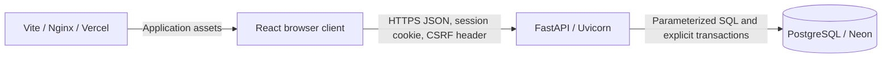

# System Architecture — MedSync / CATMS

## Layers and request flow

MedSync uses a React browser client, a FastAPI REST API and an external PostgreSQL database. The API owns authentication, permissions and business operations; PostgreSQL owns relational constraints and the stored financial/lifecycle rules. There is no ORM or browser-local database.

Source baseline: **12 October 2026**, backend `development@9e78cef`, frontend `development@2a941f6`. See [Implementation Status](implementation_status.md) for verification and release boundaries.



### Frontend

- React 19, TypeScript, Vite, React Router and Axios.
- Application CSS and manually defined utility classes; no configured Tailwind generation plugin.
- `AuthContext` confirms the session with the API; protected routes and menus control presentation, not server permissions.
- The shared Axios client sends credentials and attaches `X-CSRF-Token` to non-auth state-changing requests. A recognized CSRF rejection can refresh the token and retry once; network/server failures are not a general mutation-retry mechanism.
- Session changes clear CSRF/read state. Generation checks stop an earlier session's pending token from populating the new session.
- Simultaneous equivalent reads are coalesced in memory, not retained as a persistent medical-record cache. Acknowledged writes invalidate pending-read reuse.
- The landing directory loads current branches, contacts, specialties and counts from `/api/public/clinic-directory`. It exposes no patient details, account data, staff contacts, manager IDs or licence numbers; failed loads have a retry state, not sample-data fallback.
- Domain screens distinguish pending, failed and empty results. Selected forms prevent duplicate submissions and ignore stale responses. Shared in-page dialogs replace browser alert/confirm/prompt workflows.
- Payment handling distinguishes a rejected request, an acknowledged receipt with failed refresh, and an unknown write outcome. Reconciliation comes before another payment attempt.

### API

- Python 3.11, FastAPI, Uvicorn and Pydantic.
- Psycopg 3 `AsyncConnectionPool`, asynchronous parameterized SQL and dictionary rows.
- The pool uses autocommit for ordinary statements; multi-statement mutations explicitly enter transactions. Row/table locks must remain inside the transaction covering the whole operation.
- Argon2id hashing with legacy bcrypt verification; hashing and verification run off the event loop.
- PyJWT signs access tokens. Login sets an HttpOnly session cookie and also returns a bearer token; do not log or publish either.
- Protected dependencies recheck current account/profile authority. Role, branch, doctor relationship and patient ownership are enforced separately.
- Startup initializes the database pool. `/api/health` checks database connectivity; root metadata alone does not prove database health.

### Database

PostgreSQL is hosted externally on Neon. The source targets PostgreSQL 16+. The current SQL baseline defines 22 tables, six views, eleven functions, five procedures and eleven triggers. Those counts describe source objects, not the current cloud installation.

Lifecycle procedures and financial triggers support appointment transitions, invoice generation and receipt synchronization. Two report handlers query views; other reports use scoped joins/aggregations. The full report API is not simply a wrapper around all six views.

[Database Design](database_design.md) documents object dependencies, the treatment bridge, receipt ledger and the installed insurance validation and its remaining concurrency checks.

## Domain contracts

All paths below are relative to the default `/api` prefix. Consult the running backend's OpenAPI for full schemas and optional parameters.

| Area | Main contracts and behavior |
| --- | --- |
| Authentication | `/auth/login`, `/auth/logout`, `/auth/me`, `/auth/csrf`; username or account email under the existing JSON `username` key. No public `/auth/register`. |
| Patient records | `/patients`; nested appointments, invoices, insurance and emergency contacts. Optional portal provisioning is part of staff registration, not public sign-up. |
| Scheduling | `/appointments`; complete/cancel, emergency and reschedule actions. Patient scheduling mutations are not permitted. |
| Clinical records | `/appointments/{id}/notes`, `/notes/{id}`, `/appointments/{id}/treatments`; multiple captured-price treatment rows. |
| Billing | `POST /invoices/generate` with `appointment_id`; invoice/items reads; issued charge items cannot be edited through item-write routes. |
| Patient receipts | `/patient-payments`, `/invoices/{id}/patient-payments`; authorized receipt writes call `sp_record_patient_payment`. |
| Doctor compensation | `/doctor-payments`, legacy `/payments` and `/invoices/{id}/payments`; distinct from receipts. |
| Insurance | `/insurance/providers`, `/insurance/policies`, `/insurance/coverage`, `/insurance/claims`. |
| Administration | `/branches`, `/staff`, `/doctors`, `/specialties`, `/treatments`, `/treatment-categories`, `/users`. |
| Reports | Five management-only `/reports` GET routes; definitions in [Roles and Reports](roles_and_reports.md). |

## Execution and hosting

### Local Compose

`CATMS-Backend/compose.yaml` builds the backend plus the sibling frontend repository.

- Backend: Python image, container port 8000, host `PORT` default 8000.
- Frontend: Node 24 builder, Nginx serving compiled assets on container port 80, host port 5173.
- No PostgreSQL service, database volume or automated SQL migration step.
- `depends_on` specifies order, not a database/API readiness health check.
- Nginx supplies SPA route fallback, not an `/api` reverse proxy.
- Frontend Docker builds exclude `.env` and `.env.local`, and no API-URL build argument is defined. Its default browser API address is `http://localhost:8000/api`. A container hostname such as `backend` is not a browser-reachable API address. Review other environment filenames before packaging; they are not all covered by those two exclusions.

### Hosted topology

The current reported main deployment uses Vercel for the frontend, Azure App Service Linux for Python, and Neon for PostgreSQL. The backend deployment workflow triggers on pushes to `main` and supports manual dispatch; it uses Azure login secret references/OIDC rather than embedding credentials. It is not a development/PR acceptance-test gate.

The frontend contains a Vercel rewrite to `/index.html` for client-side navigation/refresh. Vite's API address is compiled at build time, so configuration changes require a new build. Azure must install dependencies into its runtime environment; an installation on a GitHub runner alone is insufficient. The configured startup command is:

```text
python -m uvicorn app.main:app --host 0.0.0.0 --port 8000
```

Hosted main and the development candidate are separate. Current deployed SHAs, cloud settings and browser operation were not checked for this documentation refresh.

## Configuration contract

Use local untracked configuration or the hosting platform's environment settings. Never put backend secrets in `VITE_*` variables: frontend values are public build output.

| Variable | Responsibility |
| --- | --- |
| `DATABASE_URL` | Preferred backend PostgreSQL connection string; authorized endpoint and TLS configuration. |
| `DB_HOST`, `DB_PORT`, `DB_NAME`, `DB_USER`, `DB_PASSWORD` | Backend fallback connection components; do not provision a database. |
| `DB_POOL_MIN_SIZE`, `DB_POOL_MAX_SIZE`, `DB_POOL_TIMEOUT` | Validated connection-pool bounds and wait timeout. |
| `ENVIRONMENT` | Defaults to `development`; use `production` or `prod` to activate production safety checks. |
| `JWT_SECRET_KEY`, `CSRF_SECRET_KEY` | Backend-only, explicitly configured distinct signing secrets. Production rejects built-in defaults or values shorter than 32 trimmed characters. |
| `COOKIE_SECURE`, `COOKIE_SAMESITE` | HTTPS/site cookie policy; production requires Secure, and SameSite=None requires Secure in every environment. |
| `FRONTEND_URLS` | Comma-separated allowed CORS origins, including each actual frontend origin, without route paths. |
| `VITE_API_BASE_URL` | Public browser API URL including `/api`; development fallback is localhost. |
| `PORT` | Backend/Compose port configuration; current service uses 8000. |

Production checks depend on the environment being explicitly selected; they do not certify current cloud settings. Cross-origin login requires compatible cookies, exact allowed origins and credentialed requests. CORS is not a replacement for server authorization or CSRF protection.

## Report output

The frontend prepares the loaded report snapshot and opens the native browser print dialog. The user can print or save it as PDF. There is no backend PDF route or automatic downloadable PDF response. Export uses the loaded filters and escaped dynamic text; browser page breaks, long tables and totals still need visual QA.
